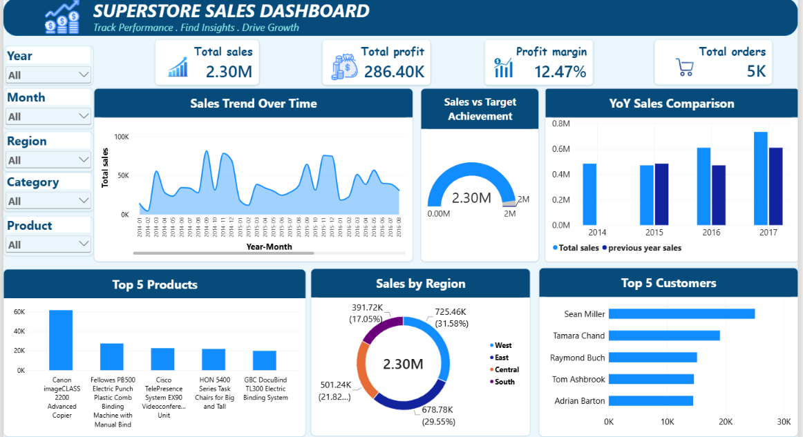

# Superstore Sales Performance and Business Insights Dashboard

## Project Overview

This project focuses on analyzing Superstore sales data using Microsoft Power BI to understand overall sales performance, product trends, and regional business performance.
An interactive dashboard was developed to transform raw sales data into meaningful business insights and support data-driven decision-making.

## Project Objectives

- Analyze overall sales and profitability.
- Identify top-performing products and categories.
- Evaluate regional sales performance.
- Understand business trends and patterns.
- Provide actionable insights through interactive visualizations.

## Tools and Technologies

- Microsoft Power BI
- Power Query
- DAX
- Microsoft Excel / CSV

## Dataset Description

The project uses Superstore sales data containing information about orders, products, customers, sales, profit, and geographical regions.
The dataset was used for data preparation, analysis, and dashboard development.

## Dashboard Pages

The dashboard consists of three interactive pages and an additional tooltip page.

### 1. Sales Performance Dashboard

Provides an overview of overall sales performance through key performance indicators and visualizations.

### 2. Product Analysis

Focuses on product-level performance, including product categories, sales contribution, and profitability.

### 3. Regional Analysis

Examines sales and profit distribution across different geographical regions to identify regional performance patterns.

### 4. Interactive Tooltip Page

Includes a custom tooltip page to provide additional contextual information when hovering over selected dashboard visuals.

## Key Performance Indicators (KPIs)

The dashboard highlights four key performance indicators:

- **Total Sales:** Represents the overall revenue generated from sales.
- **Total Profit:** Shows the total profit earned from business transactions.
- **Profit Margin:** Measures profitability as a percentage of sales.
- **Total Orders:** Displays the total number of orders received.

## Key Business Insights

The dashboard helps identify:

- Overall sales and profitability patterns.
- Top-performing product categories and products.
- Regional differences in sales and profit.
- Business areas that may require improvement.
- Opportunities for better business decision-making.

## Project Files

- **Dataset:** Original Superstore sales dataset.
- **Dashboard:** Power BI dashboard file (.pbix).
- **Images:** Dashboard screenshots.

## Dashboard Screenshots

### Sales Performance Dashboard

### Product Analysis

### Customer Insight Analysis

---

**Project:** Superstore Sales Performance and Business Insights Dashboard  
**Developed using:** Microsoft Power BI
